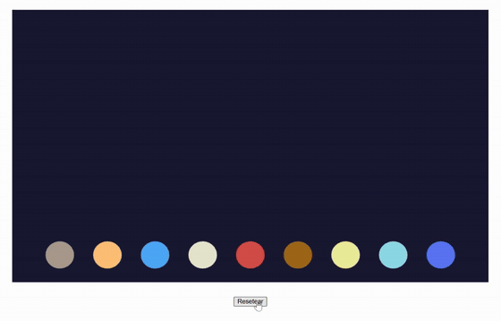

# Rebote bajo la gravedad
## [Alejandra Rodríguez Silva](https://github.com/alejandra-rs)

En el proyecto, se realiza una simulación del rebote de varios objetos al caer bajo la gravedad de distintos cuerpos celestes. En la demostración, se puede hacer clic sobre el botón "resetear" para volver a lanzar los objetos, empezando de nuevo la simulación. _[`Enlace a la aplicación en CodeSandbox`](https://codesandbox.io/p/sandbox/github/alejandra-rs/prac-IG/tree/main/prac-1)_.

## Índice

- [Implementación](#implementación)

## Implementación

Para este entregable, se han implementado las siguientes mejoras:

- **Creación de una función `drawCircle`** (en el fichero `/shapes/circle.js`). Similar a `drawRectangle`, esta función toma como parámetros de entrada el centro y el radio del círculo, y lo dibuja utilizando `gl.TRIANGLE_FAN`. Para ello, se calculan el vértice central y los vértices de la circunferencia utilizando `Math.cos` y `Math.sin`. También se ha modificado el buffer para usar `gl.DYNAMIC_DRAW` en vez de `gl.STATIC_DRAW`. Al sobreescribir constantemente los contenidos del buffer, `DYNAMIC_DRAW` permite que WebGL realice una mejor optimización de la memoria.
- **Implementación de física de rebote en el renderizado** (`/presteps.js`). Ahora, se calculan en base a la gravedad del cuerpo la velocidad (`vy`) y posición (`y`) de cada objeto. Al llegar al suelo, la velocidad se invierte, simulando el rebote. Se incluye la pérdida de energía en cada impacto mediante la constante `RESTITUTION`, haciendo que el objeto pare de moverse tras varios rebotes.
- **Corrección en la relación de aspecto** al dibujar la figura en `drawCircle`. Al representarse el espacio entre -1 y 1 en WebGL, si `canvas.width != canvas.height`, los círculos se deforman de acuerdo con la relación de aspecto del canvas. Para corregirlo, se calcula `canvas.width / canvas.height` y se aplica el coeficiente corrector al radio del eje X (`radiusX = radius / aspect`). De este modo, el círculo mantiene sus proporciones independientemente del canvas.
- **Uso de buenas prácticas de WebGL.** Se separan las distintas fases del proyecto en funciones independientes y reutilizables (`/presteps.js`). Se unifica la compilación de los shaders en una única función, `compileShader`. Se comprueba `gl.COMPILE_STATUS` para cada shader, y `gl.LINK_STATUS` para el programa, liberando los recursos en caso de fallo. Se separa la lógica (`/presteps.js`) de los datos (`/planets.js`), de modo que el código no está acoplado a los datos que se incluyen en él.
