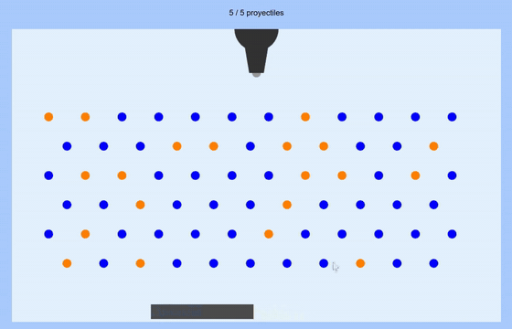

# Peggle
## [Alejandra Rodríguez Silva](https://github.com/alejandra-rs)

En esta práctica, se implementa el juego Peggle. En este juego, se dispone de 5 proyectiles para destruir todas las bolas naranjas del tablero. Debajo de las bolas se encuentra un recolector, que permite recuperar el proyectil si cae sobre él. _[`Enlace a la aplicación en CodeSandbox`](https://codesandbox.io/p/sandbox/github/alejandra-rs/prac-IG/tree/main/prac-2)_.

## Índice

- [Guía de uso](#guía-de-uso)
- [Implementación](#implementación)

## Guía de uso

El juego funciona tanto en PC como en móvil. Los controles para usar el juego son:

|     **Acción**      | **PC**  |    **Móvil**     |
| :-----------------: | :-----: | :--------------: |
|   Rotar el cañón    |  ← / →  | Deslizar izq/der |
| Lanzar el proyectil | Espacio |  Botón "Lanzar"  |

## Implementación

Para este entregable, se han implementado las siguientes mejoras:

- **Refactorización y mejora de las funciones de dibujo.** Se ha creado `drawPolygon` (`/shapes/polygon.js`), que generaliza el renderizado de polígonos: dado un array de vértices ya calculados, se encarga de subirlos al buffer y dibujar la figura. Esto simplifica `drawRectangle`, `drawCircle` y `drawTrapezoid` (creada para representar el cañón). Además, `drawCircle` ahora admite un ángulo de inicio y fin (`startAngle`/`endAngle`), permitiendo dibujar porciones de circunferencia (como el semicírculo que forma el cañón) y no solo círculos completos.
- **Implementación de rotación de figuras**, utilizada para representar el cañón en sus distintas orientaciones. Para ello, se ha implementado una matriz de transformación (`buildM` en `/shapes/polygon.js`) que combina rotación, escalado y traslación en coordenadas homogéneas (`mat3`). Estas transformaciones se aplican directamente en el vertex shader.
- **Colisiones usando el vector normal** entre el proyectil y las bolas (`checkPegCollisions`). Al chocar (distancia entre centros < suma entre radios) se aplica la fórmula de reflexión `v' = v - 2(v·n)n`, haciendo rebotar al proyectil.
- **Colisiones usando _closest point_** entre el proyectil y el recolector (`checkCollectorCollisions`). Para ello, se compara el punto más cercano del rectángulo al centro del proyectil con respecto a su radio. Al detectar solapamiento entre ambos cuerpos, el proyectil regresa al cañón y se recupera el tiro.
- **Corrección de la relación de aspecto** para que las figuras no se deformen y las colisiones coincidan con lo que se ve en pantalla.
- **Gestión de fin de partida y reinicio** a través del flag `gameRunning`. Cuando se modifica el valor de este flag al finalizar la partida, se detiene el bucle de renderizado de `requestAnimationFrame`. Esto permite dejar el tablero en su posición final, y mostrar sobre él la pantalla de fin.
- **Control diferenciado según el dispositivo**, empleando teclas en PC, y gestos en móvil. Los controles extra para móviles solo se mostrarán en dispositivos táctiles (`@media (hover: none) and (pointer: coarse)`).
