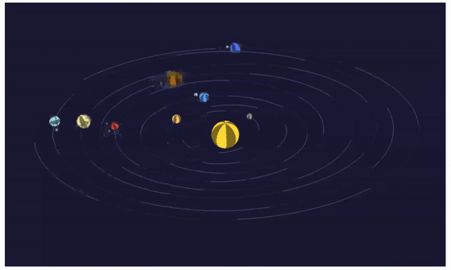

# Sistema Solar con matrices
## [Alejandra Rodríguez Silva](https://github.com/alejandra-rs)

En esta práctica se representa el Sistema Solar. El _canvas_ contiene el Sol, los 8 planetas y 12 satélites. Para la representación se han utilizado transformaciones con matrices. _[`Enlace a la aplicación en CodeSandbox`](https://codesandbox.io/p/sandbox/github/alejandra-rs/prac-IG/tree/main/prac-3)_.

## Índice

- [Guía de uso](#guía-de-uso)
- [Implementación](#implementación)

## Guía de uso

El *canvas* se controla desde la interfaz `dat.gui`:
- **Trasladar X/Y** para desplazar la escena.
- **Zoom** para acercar o alejar.
- **Rotar X/Y/Z** para girar la escena.
- **Seguir a...** para centrar la cámara en un cuerpo celeste específico.

## Implementación

Para este entregable, se han implementado las siguientes mejoras:

- **Ampliación de planetas y lunas.** Todos los cuerpos celestes se definen en `BODIES_DATA` (en `/objects.js`).
- **Realismo de los cuerpos**. Cada cuerpo cuenta con los siguientes parámetros, que aumentan su realismo:
	- `a`, `b`, `c`: formación de órbitas elípticas. El círculo unitario (en `/shapes/circle.js`) se moldea y se convierte en elipse con estos parámetros (semiejes + distancia centro-foco). 
	- `inclination`, `tiltDirection`: planos orbitales inclinados, con rotación en los ejes X y Z.
	- `spin`, `spinSpeed`: rotación de cada cuerpo sobre su propio eje (además de la traslación ya implementada).
	- `tilt`: inclinación axial del cuerpo.
- **Esferas 3D**. Cada cuerpo se representa con una esfera. Se ha creado una esfera de diámetro 1, centrada en el origen (`/shapes/sphere.js`), que se escala posteriormente al tamaño de cada cuerpo. Esta esfera se carga una única vez en GPU y es reutilizada por todos los cuerpos. Asimismo, se han realizado cambios en los *shaders*:
	- En el _vertex shader_, los vértices (`aCoordinates`) pasan a ser `vec3`, al usar coordenadas en 3 dimensiones.
	- En el _fragment shader_, se pintan franjas de colores alternos para hacer visible la rotación de los cuerpos.
- **Proyección usando `mat4.ortho`**. Corrige el aspecto y amplía la profundidad visible, para que los cuerpos no aparezcan cortados al girar o hacer zoom sobre el *canvas*. 
- **Seguir a un cuerpo con la cámara.** Al elegir un cuerpo en "Seguir a...", se guarda su posición en cada fotograma (`savePosition`). En posteriores fotogramas, la vista se traslada (con una matriz de traslación) para dejar el cuerpo en el centro.
- **Transformaciones con matrices para dibujar los cuerpos**. Se incluye una pila de matrices para poder guardarlas y restaurarlas según el cuerpo que se esté dibujando. Se realizan las siguientes transformaciones:
	- `Ortho`: proyección que corrige el aspecto y amplía la profundidad visible
	- **`S(zoom)`, `T(translateX, translateY)`, `R(rotateX, rotateY, rotateZ)`**:  transformaciones de la cámara aplicadas por el usuario.
	- **`T(-followPosition)`**: traslación de la cámara para dejar en el centro el cuerpo a seguir.
	- **`Rz(tiltDirection) · Rx(inclination)`**: orienta la órbita hacia `tiltDirection` y la inclina según `inclination`.
	- **`T(−c) · S(a, b, 1)`:** convierte el círculo unitario en una elipse (escalado), colocando al Sol en su foco (traslación).
	- `T(position)`: mueve el cuerpo a su posición en la órbita, calculada usando `Rz(angle)`.
	- `Rx(tilt)`: inclina al cuerpo sobre el eje X (inclinación axial).
	- `Rz(spin)`: gira al cuerpo sobre su eje (rotación).
	- `S(size)`: convierte la esfera de diámetro 1 al tamaño del cuerpo.
	
	 (El giro y el tamaño se aplican después de dibujar los satélites, para que no hereden estas propiedades.)
