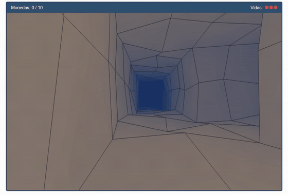

# Cueva submarina
## [Alejandra Rodríguez Silva](https://github.com/alejandra-rs)

En esta práctica se implementa un juego para la familiarización con la perspectiva y el movimiento tridimensional. En este juego, se deben encontrar 10 monedas en una cueva submarina. Al ser atacado por un pez globo, el jugador perderá una vida. Si se pierden 3 vidas, se termina el juego. El jugador cuenta con torpedos para matar a los peces globo. _[`Enlace a la aplicación en CodeSandbox`](https://codesandbox.io/p/sandbox/github/alejandra-rs/prac-IG/tree/main/prac-4)_.

## Índice

- [Guía de uso](#guía-de-uso)
- [Implementación](#implementación)

## Guía de uso

Los controles para usar el juego son:

|    **Acción**     |    **Tecla**    |
| :---------------: | :-------------: |
|      Moverse      |  W / A / S / D  |
|   Subir y bajar   | Espacio / Shift |
|  Mirar alrededor  |     Flechas     |
| Lanzar un torpedo |        F        |
| Derrapar izq/der  |      Q / E      |

## Implementación

Para este entregable, se han implementado las siguientes mejoras:

- **Escenario 3D a partir de una matriz**. El mapa (`/world/map.js`) es una matriz tridimensional de enteros. Cuenta con 8 niveles de tamaño 19x19, formando un laberinto con túneles de varios pisos. En cada coordenada, la matriz contiene un número que representa el tipo de celda (0 = agua, 1 = roca, 2 = salida). Las monedas y los peces globo no se han representado en esta matriz, pues no ocupan una celda completa, e incluirlos supondría una mayor complicación en el cálculo de colisiones. *Nota: el mapa 8x19x19 ha sido generado con inteligencia artificial, tras haberle indicado todas las restricciones que debía cumplir. Se podría equiparar su labor a la de un artista o diseñador.*
- **Proyección en perspectiva con niebla**. La cámara usa `mat4.perspective` para generar perspectiva desde 0.05 hasta 12 con un ángulo de 70º (parámetros de cámara en `/config.js`). En los *shaders*, se produce un fundido a azul, dependiente de la distancia a la cámara, que da un efecto niebla y permite disimular el corte en el plano lejano (12).
- **Renderizado de objetos tridimensionales**. Se crean una serie de mallas de formas base, que se componen con operaciones matriciales (se mantiene el uso de la pila, con `glPushMatrix()` y `glPopMatrix()`) para formar los distintos objetos:
	- **Cueva**: Se genera una malla a partir del mapa (en `/shapes/caveMesh.js`). Esta malla dibuja paredes por cada cara visible de las celdas roca. Una vez construida la malla, se deforman las esquinas ligeramente (según el parámetro `ROUGHNESS`) para dar aspecto de roca. Cada pared renderiza su *wireframe* para poder distinguir la forma de la cueva sin necesidad de introducir iluminación.  
	- **Monedas**: Esferas con *wireframes* verticales que giran y flotan con un movimiento sinusoidal.
	- **Peces globo**: Combinación de esferas (para el cuerpo y los ojos) y cubos (para las espinas). Cuando el jugador entra en su campo de visión, aumentan su tamaño (inflándose), se giran hacia él y lo persiguen.
	- **Torpedos**: Combinación de un cilindro (para el cuerpo) y una esfera (para la punta). Se mueven siguiendo la dirección de la cámara del jugador, hasta colisionar con un pez globo o una roca.
- **Cámara en primera persona y movimiento 3D**. Entre los parámetros intrínsecos del jugador (constante `player` en `/config.js`) se encuentran la posición y la orientación. La posición del jugador se almacena como un vector de tres coordenadas (x, y, z). La orientación se almacena como una matriz 4x4 de rotación, que guarda hacia dónde mira la cámara. Esta matriz permite calcular los parámetros de `mat4.lookAt`, la dirección de movimiento y la dirección de los torpedos. Las flechas arriba/abajo giran la cámara sobre el eje X del jugador, y las flechas izquierda/derecha la giran sobre el eje Y del mundo, para poder girar el submarino sin que se incline el horizonte. 
- **Movimiento con aceleración, frenado y derrape**. El movimiento se ha modelado con un vector velocidad, que se ve modificado por la aceleración y el rozamiento. Las teclas de movimiento varían la velocidad del submarino (y no su posición). Al derrapar (Q hacia la izquierda, E hacia la derecha), se reduce el agarre del submarino, que gira sobre el eje Y del mundo, deslizándose.
- **Control de colisiones**. Las colisiones se controlan de distintas formas según los objetos que choquen:
	- **Submarino y torpedos contra una roca:** Se comprueba si el siguiente movimiento va a invadir una celda roca. En el caso del submarino, se hace de forma independiente para cada eje, para permitir que se deslice por la pared.
	- **Pez globo contra roca:** Se calcula si la distancia al punto más cercano de la roca al pez es menor que el radio del pez. En caso de ser así, se empuja al pez hacia fuera para que deje de tocar la roca.
	- **Entre objetos (peces, torpedos, monedas y submarino):** Se comparan la distancia entre centros y la suma de los radios.
- **Gestión de fin de partida y reinicio**. Cuando el jugador captura todas las monedas o pierde todas sus vidas, se finaliza la partida y se detiene el bucle de renderizado de `requestAnimationFrame`. Esto permite dejar el tablero en su posición final, y mostrar sobre él la pantalla de fin.
