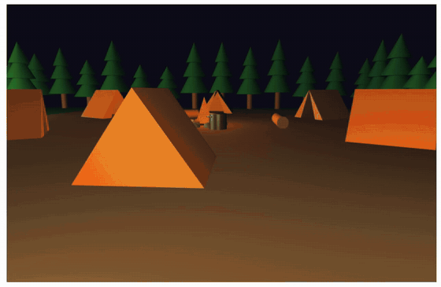

# Bosque de noche
## [Alejandra Rodríguez Silva](https://github.com/alejandra-rs)

En esta práctica se puede explorar un bosque de noche con 2 campamentos. El objetivo es estudiar la iluminación con el modelo de Phong y la contribución de los distintos tipos de luces. _[`Enlace a la aplicación en CodeSandbox`](https://codesandbox.io/p/sandbox/github/alejandra-rs/prac-IG/tree/main/prac-5)_.

## Índice

- [Guía de uso](#guía-de-uso)
- [Implementación](#implementación)

## Guía de uso

Los controles son:

|       **Acción**        | **Tecla**     |
| :---------------------: | :-----------: |
|         Moverse         | W / A / S / D |
|          Mirar          |    Flechas    |
| Encender/apagar linterna |       F       |

Los ajustes de iluminación se pueden controlar desde la interfaz `dat.gui`, situada bajo el *canvas*:
- **Phong**: porcentaje de luz ambiente, difusa y especular, y amplificación de *shininess*.
- **Lámparas y hogueras**: factor de atenuación y encendido/apagado de las luces.
- **Luna**: encendido/apagado y dirección de la luz (X, Y, Z).
- **Linterna**: ángulo interno (luz al 100%) y externo (atenuación de la luz).

## Implementación

Para este entregable, se han implementado las siguientes mejoras:

- **Escenario a partir de una matriz.** El mapa (`/world/map.js`) es una matriz de 25x25, donde cada celda indica su tipo (0 = césped, 1 = árbol, 2 = inicio, 3 = camino, 4 = campamento, 5 = lámpara). Contiene dos campamentos de 9x9 unidos por un camino, con 14 lámparas a ambos lados, rodeados de árboles. A partir del mapa se genera una lista de entidades (`ENTITIES`) con todos los objetos, que simplifica la renderización, el cálculo de colisiones y el cómputo de luces.
- **Mallas con normales.** Se han reutilizado las mallas para las formas base (`/meshes`): esfera, cubo, cilindro, cono y tienda de campaña. Como añadido, dado que se cuenta con cálculo de luces, también se computan los vectores normales de los vértices de cada malla. En las caras planas (cubo, tapas del cilindro, base del cono, tienda) los vértices se duplican, para que cada cara tenga su propia normal. Con estas mallas se componen los objetos de la escena, usando la pila de matrices como en prácticas anteriores.
- **Conversión de normales.** Las normales se transforman aplicando `mat3.normalFromMat4` a `modelMatrix` (`/render/core.js`), para que sigan siendo perpendiculares a la superficie aunque el objeto se escale de forma no uniforme.
- **Materiales.** Cada material (`MATERIALS` en `/config.js`) define sus componentes ambiente, difusa, especular y *shininess*, que se envían al *shader* como *uniforms* antes de dibujar cada objeto. Los objetos que emiten luz (fuego de la hoguera, bombilla de la lámpara) usan solo componente ambiente.
- **Iluminación de Phong.** El *vertex shader* solo transforma la posición y la normal al sistema de referencia de la cámara. Las luces también se transforman al sistema de referencia de la cámara, desde `/render/lights.js`. El cálculo de la luz se realiza en el *fragment shader* para cada píxel, de acuerdo con el modelo de Phong. De esta forma, las zonas iluminadas por las lámparas se ven correctamente incluso sobre polígonos grandes (como el suelo, que solo tiene 4 vértices). En mallas abiertas (como las tiendas de campaña), si una cara se está viendo por detrás se invierte su normal, para que su interior también reciba la luz correctamente. En este cálculo de la luz se tienen en cuenta las componentes ambiente, difusa y especular, cada una multiplicada por el coeficiente configurado desde `dat.gui`.
- **Tipos de luces**. Se implementan 3 tipos de luces, cada una de ellas contribuyendo al cómputo de color de cada píxel:
	- **Puntuales (hogueras y lámparas)**: se generan a partir de `ENTITIES` (`/render/lights.js`). Su intensidad decrece con la distancia según la atenuación `1 / (1 + k·(d + d²))`. El coeficiente `k` es configurable desde `dat.gui`.
	- **Direccional (luna)**: luz tenue y azulada que llega a todo el escenario desde una dirección, sin atenuación.
	- **Foco (linterna)**: sale de la cámara en la dirección de la mirada. Ilumina por completo dentro del ángulo interno y se atenúa hasta el ángulo externo.
- **Niebla.** Como en la práctica anterior, los objetos se funden con el color de la niebla según su distancia a la cámara.
- **Cámara, movimiento y gestión de colisiones.** Se mantienen de la práctica anterior la cámara en primera persona con matriz de orientación y el control de colisiones por eje. Se ha modificado el movimiento para limitar el giro vertical de la cámara y desplazarse siempre en `y = 0.6`, a la altura de la cámara.
