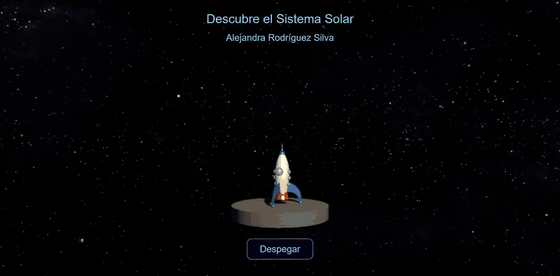
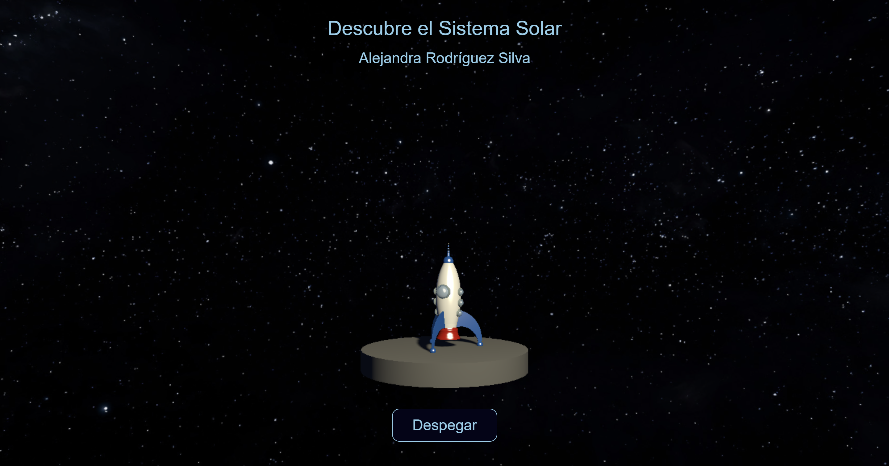
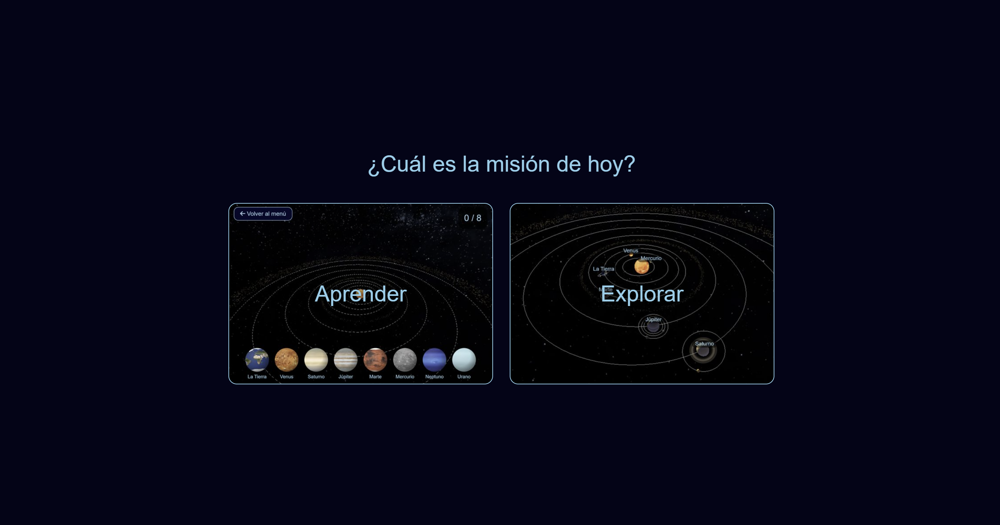
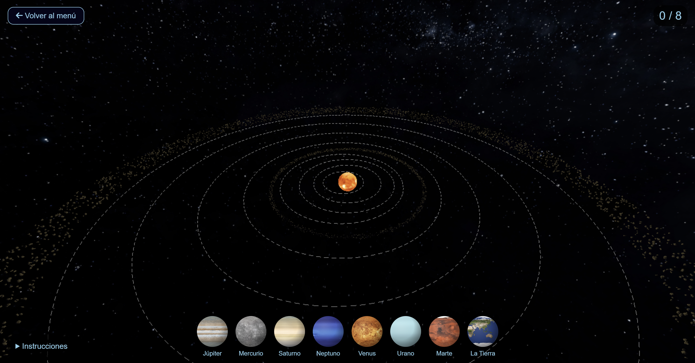
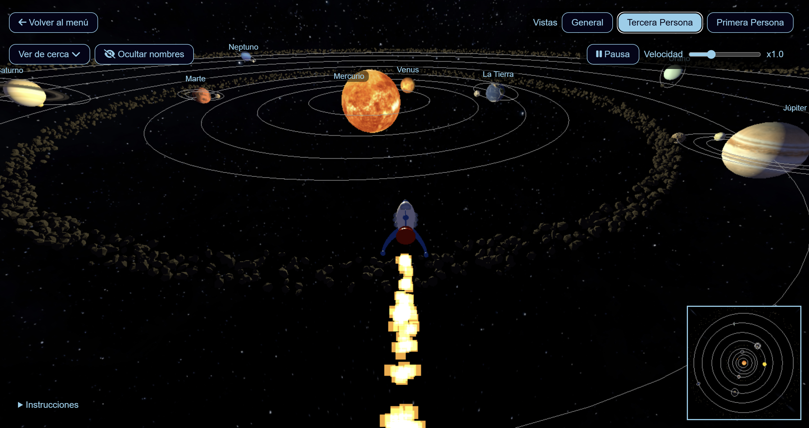
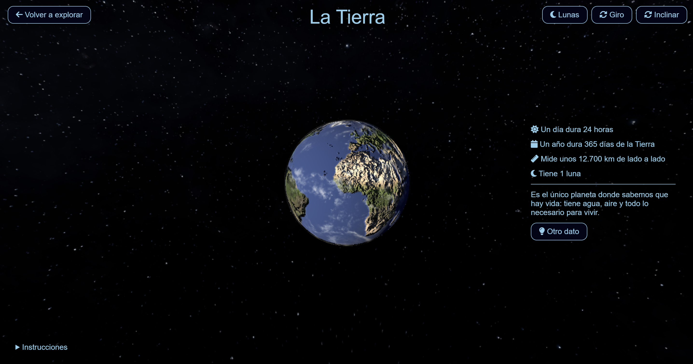

# Descubre el Sistema Solar
## [Alejandra Rodríguez Silva](https://github.com/alejandra-rs)

<p align="center">
  <a href="https://youtu.be/kHiZgxsxbjM"></a>
  <br>
  <sub><i><a href="https://youtu.be/kHiZgxsxbjM">↑ Enlace al vídeo explicativo de la aplicación</a></i></sub>
</p>

_**Descubre el Sistema Solar**_ es una aplicación hecha con `three.js` para aprender sobre el Sistema Solar jugando. En ella, los niños pueden colocar cada planeta en su órbita, explorar el sistema solar y descubrir curiosidades sobre los distintos cuerpos. Este programa se ha desarrollado como sexta práctica de la asignatura _Informática Gráfica_. _[`Enlace a la aplicación en CodeSandbox`](https://codesandbox.io/p/sandbox/github/alejandra-rs/prac-IG/tree/main/prac-6)_.

## Índice

- [Guía de uso](#guía-de-uso)
  - [Inicio](#inicio)
  - [Menú](#menú)
  - [Aprender](#aprender)
  - [Explorar](#explorar)
  - [Ver de cerca](#ver-de-cerca)
- [Implementación](#implementación)
  - [Objetos 3D](#objetos-3d)
  - [Texturas y materiales](#texturas-y-materiales)
  - [Luces y sombras](#luces-y-sombras)
  - [Cámaras y controles](#cámaras-y-controles)
  - [Interacción](#interacción)
  - [Efectos e interfaz](#efectos-e-interfaz)
- [Estructura del código](#estructura-del-código)
- [Escala](#escala)
- [Fuentes](#fuentes)


## Guía de uso

### Inicio

<p align="center"></p>

En la pantalla de inicio de la aplicación, aparece un cohete sobre la plataforma de lanzamiento. Al pulsar el botón `Despegar`, suena una cuenta atrás y el cohete despega.

> [!NOTE]
> Esta pantalla de inicio está inspirada en uno de mis juegos favoritos de mi infancia, en el que había que construir un cohete y enviarlo al espacio. Al lanzarlo, sonaba "_Three, Two, One... IGNITION!_".

### Menú

<p align="center"></p>

El menú permite realizar dos tipos de misiones:

- **Aprender:** conocer las órbitas de los planetas construyendo el Sistema Solar.
- **Explorar:** viajar libremente con un cohete por el Sistema Solar.

Desde cualquier misión se puede volver al menú con el botón de la flecha.

### Aprender

<p align="center"></p>

En el modo aprendizaje, aparecen órbitas vacías y planetas en una bandeja en la parte inferior. El objetivo es arrastrar cada planeta a su órbita correspondiente. Si la órbita no es correcta, aparece un mensaje de ayuda y el planeta se devuelve a la bandeja. También se puede devolver un planeta bien colocado a la bandeja, haciendo clic sobre él.

En la esquina superior izquierda, aparece un contador con el número de planetas colocados. Al colocar los ocho correctamente, se permite empezar de nuevo.

### Explorar

<p align="center"></p>

Se puede explorar el Sistema Solar con tres vistas distintas:

- **General:** vista objetiva del Sistema Solar, sobre la que se puede rotar y ampliar.
- **Tercera persona:** vista subjetiva del cohete en tercera persona, la cámara detrás de él.
- **Primera persona:** vista subjetiva del cohete en primera persona, como si se estuviera dentro de él.

Controles del cohete:

<div align="center">

| Tecla | Acción |
| --- | --- |
| W / S | Avanzar y retroceder |
| A / D | Izquierda y derecha |
| R / F | Subir y bajar |
| Q / E | Girar el cohete |
| Flechas / ratón | Mirar alrededor |

</div>

En la primera y tercera persona aparece un **minimapa** en la esquina inferior derecha. En este, se ve el Sistema Solar desde arriba y se marca el cohete en amarillo.

Otras funcionalidades:

- **Nombres:** muestra u oculta los nombres de los planetas.
- **Pausa:** frena el movimiento de los planetas y lunas.
- **Velocidad:** cambia lo rápido que pasa el tiempo, de x0.2 a x3.
- **Aviso de cercanía:** con la simulación pausada, si el cohete está cerca de un cuerpo, aparece un botón para verlo de cerca.

### Ver de cerca

<p align="center"></p>

Al acercarse a un cuerpo, o desde el desplegable **«Ver de cerca»**, se puede ver este cuerpo de cerca. Aparece el cuerpo solo y en primer plano. Sobre esta vista se puede rotar y ampliar. 

A la derecha del cuerpo se muestra su _ficha técnica_. Sobre ella, se pueden consultar distintas informaciones y datos curiosos.

Además, esta vista cuenta con una serie de botones:

- **Lunas:** muestra u oculta las lunas del planeta.
- **Giro:** activa o desactiva el giro del cuerpo sobre sí mismo.
- **Inclinar:** muestra unos anillos de colores para rotar el cuerpo sobre distintos ejes.


## Implementación

Para esta práctica, se han implementado las siguientes funcionalidades:

### Objetos 3D

- **Sol, planetas y lunas.** Todos los cuerpos se definen en `sun` y `planets` (en `/data/planets.js`): el Sol, los ocho planetas y nueve lunas. Cada cuerpo es una `SphereGeometry` creada en `/objects/scene.js`:
	- `createStar`: el Sol, con una `PointLight` en su interior.
	- `createPlanet`: un `Group` con la malla del planeta, su etiqueta y un plano para sus lunas (`moonPlane`).
	- `createMoon`: se crea la luna sobre un pivote(`Object3D`), que permite simplificar su rotación.
- **Realismo de los cuerpos.** Cada cuerpo cuenta con los siguientes parámetros:
	- `distance`, `eccentricity`: órbitas elípticas. A partir de ellas se calculan `yScale` (ratio entre semiejes) y `xOffset` (distancia centro-foco), que se usan para dibujar la órbita (`EllipseCurve` en `createOrbit`) y para mover el planeta (`movePlanets`, en `/index.js`).
	- `tilt`: inclinación del eje. El `moonPlane` tiene la misma inclinación, para que las lunas orbiten sobre el ecuador de su planeta.
	- `spin`, `speed`: velocidad de rotación y traslación de cada cuerpo.
	- `inclination` (lunas): inclinación de la órbita de cada luna respecto al ecuador de su planeta.
- **Anillos de Saturno.** Se utiliza `RingGeometry` con una textura PNG. Se realiza un _UV mapping_ (en `createRing`) para que la textura se aplique radialmente.
- **Cinturones de asteroides.** Los cinturones de asteroides (principal y Kuiper) se implementan con `InstancedMesh` (`/objects/asteroids.js`). En cada uno se posicionan rocas (`IcosahedronGeometry`) con posición, rotación y escala aleatorias.
- **Cohete.** Modelo 3D cargado con `GLTFLoader` (`/objects/rocket.js`).
- **Plataforma de lanzamiento.** En la pantalla de inicio (`/modes/start.js`), se utiliza `CylinderGeometry` para crear la plataforma de lanzamiento.

### Texturas y materiales

- **Texturas.** Todos los cuerpos configuran su textura utilizando:
	- `map`: textura (colores).
	- `bumpMap`: relieve. Salvo en la Tierra (que tiene su propio mapa de relieve), se reutiliza la textura para generar el mapa de relieve. Cada cuerpo cuenta con un nivel de rugosidad (`bumpScale`).
	- `alphaMap`: transparencia. Se usa para la capa de nubes de la Tierra.
	- Caché de texturas (`textureCache`): se utiliza para agilizar la carga y abrir más rápidamente las vistas.
- **Materiales.**
	- `MeshStandardMaterial`: planetas, lunas y asteroides.
	- `MeshBasicMaterial`: el Sol, que brilla y no se ve afectado por la luz.
	- `MeshPhongMaterial`: aplicado sobre el cohete, con `specular` y `shininess`, para simular el brillo del metal.

### Luces y sombras

Se usan cinco tipos de luz:

<div align="center">

| Luz | Escena | Efecto | Sombras |
| --- | --- | --- | --- |
| `PointLight` | Sistema Solar (dentro del Sol) | Luz en todas direcciones desde el centro | No |
| `AmbientLight` | Sistema Solar e inicio | Luz tenue general en toda la escena | No |
| `DirectionalLight` | Ver de cerca | Iluminación lateral en la vista | Sí |
| `HemisphereLight` | Ver de cerca | Luz suave, similar a la luz ambiental | No |
| `SpotLight` | Inicio | Foco sobre la plataforma y el cohete | Sí |

</div>

Para habilitar las sombras, se deben activar desde el renderizador (`renderer.shadowMap`, de tipo `PCFSoftShadowMap`). Cada objeto que se ve afectado por las sombras (cuerpos) habilita el efecto usando `castShadow` y `receiveShadow`. Solo algunas luces generan sombra, permitiendo añadir la generación del mapa de sombras con `castShadow`:

- **`DirectionalLight`, en la vista de cerca:** sombra de los anillos sobre Saturno o de las lunas sobre su planeta.
- **`SpotLight`, en la pantalla de inicio:** sombra del cohete sobre la plataforma.

_La luz puntual del Sol no genera sombras, pues supondría generar mucho cómputo adicional (6 mapas de sombras) para un efecto prácticamente inapreciable._

### Cámaras y controles

- **Controles.** Se implementan distintos controles para las vistas de la aplicación (`setView`, en `/views.js`):
	- `OrbitControls`: vista general, vista de cerca y pantalla de inicio.
	- `FlyControls`: movimiento del cohete en la primera y tercera persona (`createRocketControls`). Sobre estos controles, la cámara sigue automáticamente al cohete.
	- `TransformControls` en modo `rotate`, en la vista de cerca, para inclinar el cuerpo. Mientras se utilizan estos controles, los `OrbitControls` se desactivan (`dragging-changed`).
- **Escenas separadas.** Los distintos modos tienen su escena, cámara y controles. El bucle de animación dibuja una u otra según el estado del juego (`getState`).
- **Minimapa.** Implementado como una `OrthographicCamera`, mostrando una vista cenital y ubicado en la esquina inferior derecha (`setViewport`, `setScissor` y `setScissorTest`). Se coloca el marcador amarillo del cohete sobre él, en la capa 1, para solo hacerlo visible sobre la cámara del minimapa.
- **Cambio de tamaño de la ventana.** La ventana se adapta automáticamente tras ser redimensionada, actualizando los renderizadores y el _aspect ratio_ de las cámaras.

### Interacción

- **Añadir y eliminar planetas** (`/modes/learn.js`). En el modo aprendizaje, se implementa un sistema de _drag and drop_ para arrastrar cada planeta a su órbita:
	- **Añadir:** al soltar el planeta, se calcula el punto de intersección entre el puntero y el plano `y = 0`, para después encontrar la órbita más cercana (a través de un `Raycaster` en `intersectPlane` y `findNearestPlanet`). Tras obtener la órbita, se compara con la órbita real del planeta y se actúa en consecuencia.
	- **Eliminar:** al hacer clic sobre un planeta colocado, el `Raycaster` lo detecta (`removePlanet`) y lo devuelve a la bandeja.
- **Vista de cerca** (`/modes/closeup.js`). Se muestra una vista del cuerpo elegido con mayor resolución, solo y en primer plano. Al salir, se recupera el estado anterior.
- **Aviso de cercanía** (`/modes/proximity.js`). Con la simulación pausada, se calcula la distancia del cohete a la superficie de cada cuerpo. Si alguno está cerca, se muestra un mensaje para verlo de cerca.
- **Colisiones** (`/objects/collisions.js`). Se controlan las colisiones evitando movimientos que introduzcan al cohete en los cuerpos.
- **Pausa y velocidad** (`/game.js`). Se usa un `THREE.Clock` para gestionar el tiempo de simulación. El _delta_ obtenido permite ajustar el movimiento, junto con la pausa y la velocidad.


### Efectos e interfaz

- **Partículas del motor** (`/objects/particles.js`). Se utilizan `THREE.Points` en la cola del cohete, utilizando `AdditiveBlending` y `PointsMaterial` para dar efecto de fuego. Las partículas se mueven aleatoriamente con un máximo de separación del cohete, cuando este está en movimiento.
- **Sonidos** (`/objects/sounds.js`). `AudioListener`, `Audio` y `AudioLoader` de `three.js`, utilizados para:
	- Cuenta atrás para lanzar el cohete. Solo se reproducen los últimos 5 segundos (`offset`).
	- Sonido del motor, con volumen adaptable según se mueve el cohete.
- **Interfaz.**
	- Nombres de los planetas con `CSS2DRenderer`: elementos HTML que siguen a cada planeta.
	- Panel de instrucciones distinto en cada pantalla y vista (`/help.js`).

## Estructura del código

```bash
src/
├── index.html, index.css   # Página e interfaz
├── index.js                # Escena principal y bucle de animación
├── game.js                 # Estado del juego
├── views.js                # Vistas (cámaras y controles)
├── help.js                 # Panel de instrucciones
├── data/                   # Información de los planetas
│   └── ...
├── objects/                # Construcción y comportamiento de objetos
│   ├── scene.js                # Cuerpos celestes
│   ├── asteroids.js            # Cinturones de asteroides
│   ├── rocket.js               # Cohete
│   ├── particles.js            # Partículas del motor
│   ├── collisions.js           # Colisiones
│   └── sounds.js               # Sonidos
├── modes/                  # Pantallas de la aplicación
│   └── ...
├── textures/, models/, sounds/, img/ # Elementos importados
```

## Escala

Los tamaños y las distancias **no son reales**. De serlo, los planetas se verían muy pequeños y alejados, perdiendo el carácter didáctico de la aplicación.

## Fuentes

### Modelo 3D

- [Rocket](https://sketchfab.com/3d-models/rocket-36ac04d6203545b1baf56c4cbf89349b) de [Rafa Andrade](https://sketchfab.com/rafa_andrade), con licencia [CC-BY-4.0](http://creativecommons.org/licenses/by/4.0/)

### Texturas

- [Solar System Scope](https://www.solarsystemscope.com/textures/) (también el mapa de relieve de la Tierra)
- [DeviantArt](https://www.deviantart.com/)

### Iconos

- [Font Awesome](https://fontawesome.com/)

### Documentación y tutoriales

- [three.js](https://threejs.org/)
- [Applying a texture to a RingGeometry (three.js forum)](https://discourse.threejs.org/t/applying-a-texture-to-a-ringgeometry/9990/4)
- [Saturn rings with SvelteKit and three.js (veenie.space)](https://veenie.space/research/saturn-rings-sveltekit-threejs)
- [MeshStandardMaterial (three.js docs)](https://threejs.org/docs/#MeshStandardMaterial)
- [Discover three.js](https://discoverthreejs.com/)
- [Loading 3D models (three.js manual)](https://threejs.org/manual/#loading-3d-models)
- [Load models (Discover three.js)](https://discoverthreejs.com/book/first-steps/load-models/)
- [Creating text (three.js manual)](https://threejs.org/manual/#creating-text)
- [CSS2DRenderer (three.js docs)](https://threejs.org/docs/?q=css#CSS2DRenderer)
- [FlyControls (three.js docs)](https://threejs.org/docs/#FlyControls)
- [TransformControls (three.js docs)](https://threejs.org/docs/#TransformControls)
- [TransformControls (SBCODE)](https://sbcode.net/threejs/transform-controls/)
- [AudioLoader (three.js docs)](https://threejs.org/docs/#AudioLoader)

### Sonidos

- Efecto de sonido de [Gavin Mogensen](https://pixabay.com/users/fronbondi_skegs-23154649/?utm_source=link-attribution&utm_medium=referral&utm_campaign=music&utm_content=283448) en [Pixabay](https://pixabay.com/sound-effects//?utm_source=link-attribution&utm_medium=referral&utm_campaign=music&utm_content=283448)
- Efecto de sonido de [voiceofruthie](https://pixabay.com/users/voiceofruthie-46882009/?utm_source=link-attribution&utm_medium=referral&utm_campaign=music&utm_content=322691) en [Pixabay](https://pixabay.com//?utm_source=link-attribution&utm_medium=referral&utm_campaign=music&utm_content=322691)

### Música del vídeo

- Música de [Dmitrii Kolesnikov](https://pixabay.com/users/the_mountain-3616498/?utm_source=link-attribution&utm_medium=referral&utm_campaign=music&utm_content=438391) en [Pixabay](https://pixabay.com/music//?utm_source=link-attribution&utm_medium=referral&utm_campaign=music&utm_content=438391)

### Datos curiosos

- [Curiosidades de los planetas del sistema solar para niños (Horizontes Espacio)](https://horizontesespacio.net/astronomia/curiosidades-de-los-planetas-del-sistema-solar-para-ninos/)
- [Curiosidades del sistema solar para niños (AstroInGeo)](https://blog.astroingeo.org/sistema-solar/curiosidades-del-sistema-solar-para-ninos)
- [39 curiosidades sobre los planetas (Curiosidades Sobre)](https://curiosidadessobre.es/39-curiosidades-sobre-los-planetas)

*Se ha utilizado el autocompletado brindado por Copilot en Visual Studio code para la implementación de algunas funciones básicas.*