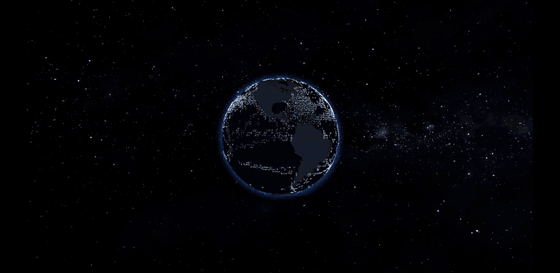
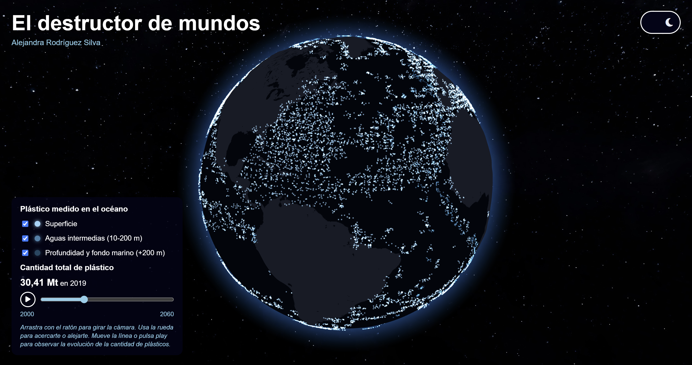
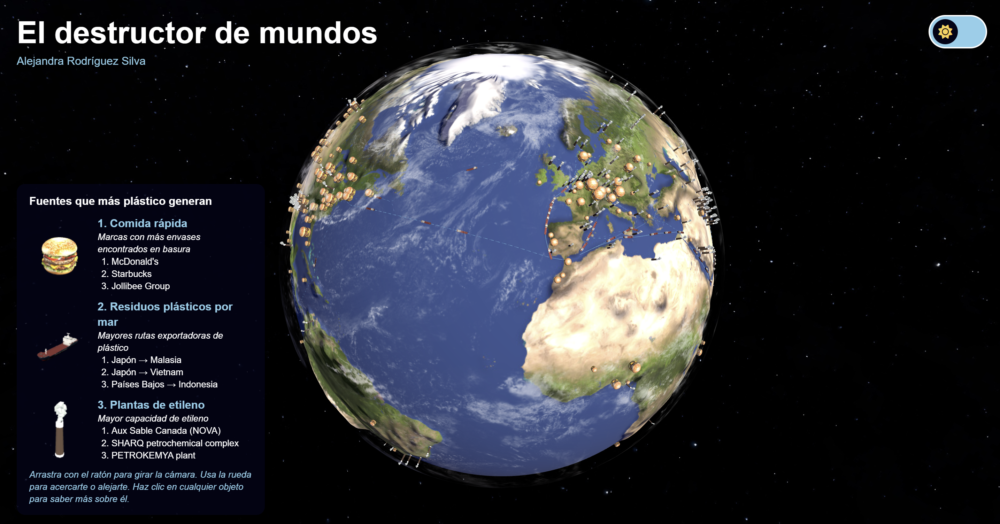

# El destructor de mundos
## [Alejandra Rodríguez Silva](https://github.com/alejandra-rs)

<p align="center">
  <a href="./doc/video.mp4"></a>
  <br>
  <sub><i><a href="./doc/video.mp4">↑ Enlace al vídeo explicativo de la aplicación</a></i></sub>
</p>

_**El destructor de mundos**_ es una visualización de datos realizada con `three.js` sobre el plástico en el océano. En ella, se observan 2 vistas de la Tierra: la primera, _de noche_, en donde se registran las medidas de microplásticos en el mar de 2000 a 2060; y la segunda, _de día_, en la que se observa la realidad que ha llevado a toda esta contaminación. Este programa se ha desarrollado como séptima práctica de la asignatura _Informática Gráfica_. _[`Enlace a la aplicación en CodeSandbox`](https://codesandbox.io/p/sandbox/github/alejandra-rs/prac-IG/tree/main/prac-7)_.

## Índice

- [Guía de uso](#guía-de-uso)
  - [Noche - Microplásticos en el Océano](#noche---microplásticos-en-el-océano)
  - [Día - Fuentes Generadoras de Plástico](#día---fuentes-generadoras-de-plástico)
- [Implementación](#implementación)
  - [Objetos 3D](#objetos-3d)
  - [Texturas y materiales](#texturas-y-materiales)
  - [Luces](#luces)
  - [Cámaras y controles](#cámaras-y-controles)
  - [Interacción](#interacción)
- [Datos](#datos)
  - [Reproducir los datos](#reproducir-los-datos)
  - [Contenido de data.json](#contenido-de-datajson)
- [Estructura del código](#estructura-del-código)
- [Fuentes](#fuentes)


## Guía de uso

En todos los modos, los controles son:

<div align="center">

| Acción | Control |
| --- | --- |
| Girar el globo | Arrastrar con el ratón |
| Acercar y alejar | Rueda del ratón |
| Cambiar entre noche y día | Interruptor de la esquina superior derecha |
| Ver información de un objeto | Clic sobre él |
| Salir de la vista de un objeto | `Esc` o botón × de la tarjeta |

</div>

### Noche - Microplásticos en el Océano



En su versión nocturna, se muestra el globo terráqueo con puntos brillantes sobre él. Estos puntos representan el plástico medido en distintas zonas del océano. El panel de la esquina inferior izquierda permite:

- **Elegir las capas:** superficie, aguas intermedias (10-200 m) y profundidad y fondo marino (más de 200 m). Cada una se puede activar y desactivar por separado.
- **Mover la línea temporal** de 2000 a 2060. Se muestra la cantidad total de plástico acumulado en los océanos hasta ese año, en millones de toneladas. Al avanzar los años, se observa como en cada zona aparecen más puntos y estos se dispersan más.

### Día - Fuentes Generadoras de Plástico



Al mostrar la Tierra de día, aparecen las fuentes de esta generación inhumana de plástico. Estas fuentes han sido extraídas del estudio de [Morales-Caselles et al. (2021)](https://doi.org/10.1038/s41893-021-00720-8): comida rápida, actividades marítimas y otras industrias. El tamaño de cada objeto es proporcional a su importancia:

- **Comida rápida:** datos basados en el estudio de [Cowger et al. (2024)](https://doi.org/10.1126/sciadv.adj8275), en el que se realizó una inspección de las basuras de un gran número de países en busca de embalajes plásticos de distintas marcas.
- **Actividades marítimas:** se utilizan las 50 rutas exportadoras de plástico más importantes. Se muestra un barco por cada una, con su ruta dibujada. Los datos provienen de [UN Comtrade](https://comtradeplus.un.org/), de [UNCTAD](https://unctadstat.unctad.org/datacentre/dataviewer/US.PLSCI) y de [searoute](https://github.com/genthalili/searoute-py).
- **Plantas de etileno:** para representar las industrias, se utilizan plantas de etileno, pues con este material se fabrica la mayor parte del plástico. Se representa cada planta productora con una chimenea. Los datos provienen de la [Global Ethylene Production Database](https://doi.org/10.5281/zenodo.17866398), elaborada por la Spatial Finance Initiative.

Al hacer clic sobre un objeto, se abre una tarjeta con su información. Esta tarjeta también se muestra automáticamente al acercar la cámara a la superficie, con el objeto que quede en el centro de la pantalla.

Si se selecciona un barco, la cámara se sitúa detrás de él y lo acompaña durante su recorrido. Se puede volver a la vista general con `Esc`, cerrando la tarjeta o esperando a que el barco termine su ruta.


## Implementación

Para esta práctica, se han implementado las siguientes funcionalidades:

### Objetos 3D

- **Globo:** el globo es una `SphereGeometry` de 512 × 256 segmentos (`createGlobe`, en `/objects/globes.js`) con un mapa de desplazamiento (`displacementMap`), que modifica el mallado de la esfera para dar relieve a los continentes. En la vista de día, se añade además una capa de nubes, usando otra esfera con `alphaMap` que gira lentamente en sentido contrario.
- **Fondo estrellado:** implementada como una esfera muy grande con la textura de estrellas en su cara interior (`BackSide`).
- **Hamburguesas, chimeneas y barcos:** modelos `.glb` cargados con `GLTFLoader` (`/objects/plasticSources.js`) y escalados a un tamaño común con `fitToSize`. Cada copia se coloca sobre la superficie usando la normal del globo como eje vertical (`placeOnSurface`, en `/objects/terrain.js`), y su tamaño depende de su importancia (`/data.js`).
- **Presencia de microplásticos:** cada capa de microplásticos se implementa con `THREE.Points` (`createPlasticLayer`, en `/objects/plastic.js`). Cada zona (2° × 2°) se convierte en varios puntos colocados aleatoriamente en su superficie, siguiendo una distribución normal. 
- **Rutas de los barcos:** la ruta de cada barco es una línea discontinua (`Line` con `LineDashedMaterial`), calculada en `/objects/shipRoutes.js`. Las esquinas del camino se redondean con curvas de Bézier, para suavizarlas sin desviarse significativamente de la ruta real.

### Texturas y materiales

- **Texturas:** se usan `earth.jpg` para los colores de la Tierra, `clouds.jpg` para la transparencia de las nubes y `stars.jpg` para el fondo.
- **Vista nocturna:** usa un `MeshLambertMaterial` con la textura `earth_night.png` como `emissiveMap`. De esta forma, la Tierra parece iluminarse solo con los puntos de plástico.
- **Relieve:** el mapa de relieve (`earth_bump_map.jpg`) se suaviza con un desenfoque de caja (`BLUR_RADIUS` y `BLUR_PASSES`, en `/objects/terrain.js`) y se convierte en una `DataTexture`. Este mapa se usa como `displacementMap`, para mover los vértices de la esfera, y en la vista de día también como `bumpMap`, para tener un mejor efecto de sombreado. De esta forma, las sombras y relieves se ven suavizados.
- **_Halo_ en la vista nocturna:** por la noche, el globo está rodeado por una esfera un poco más grande con un `ShaderMaterial` que brilla más en los bordes, creando un efecto de _halo_.
- **Puntos de plástico:** cada capa usa su propio `ShaderMaterial` (`/objects/plastic.js`):
	- El _vertex shader_ ajusta el tamaño de cada punto según su distancia a la cámara, para que se vea bien con cualquier zoom, y oculta los puntos que aún no aparecen en el año elegido.
	- El _fragment shader_ dibuja cada punto como un círculo que se difumina hacia los bordes.
	- Con `AdditiveBlending`, los puntos brillan más donde se acumulan.

### Luces

En la aplicación, solo se usan 2 luces, ambas en la escena de día:

- `DirectionalLight`: Luz del sol. Está unida a la cámara para que el globo siempre esté iluminado por delante.
- `AmbientLight`: Luz tenue azulada, para que la parte en sombra no quede completamente negra.

La Tierra no usa ninguna luz en su vista nocturna, ya que se ilumina con su textura `emissive`.

### Cámaras y controles

- **Controles:** `OrbitControls` con `enableDamping`, sin desplazamiento lateral (`enablePan: false`) y con `minDistance` y `maxDistance`. La rotación automática (`autoRotate`) se desactiva una vez el usuario mueve manualmente el globo terráqueo.
- **Escenas diurnas y nocturnas:** cada vista es una `Scene` con su globo y los objetos que contiene. En cada fotograma, `renderer.render` recibe la vista que debe mostrar según el estado del interruptor (`areLightsOff`), manteniendo la cámara.
- **Vista desde un barco** (`/shipCamera.js`)**:** al seleccionar un barco, se desactivan los `OrbitControls` y la cámara viaja hasta situarse detrás de él. El viaje se anima con `TWEEN`, interpolando la posición, la orientación y el punto de mira de la cámara. Como la posición de destino se calcula en cada fotograma con `localToWorld`, la cámara sigue al barco mientras avanza.
- **Introducción** (`playIntro`)**:** otro `TWEEN.Tween` reduce la distancia de la cámara al globo.
- **Tamaño de la ventana:** al redimensionar la ventana, se actualizan el tamaño del renderizador, el `aspect` de la cámara y el tamaño de los puntos.

### Interacción

- **Selección de objetos** (`/infoCard.js`)**:** la posición de cada objeto se proyecta a la pantalla con `project` y se elige el más cercano al puntero, entre los que están en la cara visible del globo. Los arrastres no son considerados para este cálculo, pues mueven la Tierra en su lugar.
- **Información:** al hacer clic sobre un objeto, aparece una tarjeta con sus datos (`userData`). Si la cámara está cerca de la superficie, se muestra el objeto cuya posición está más alineada con la cámara (producto escalar).
- **Línea temporal (`/panels.js`, `/objects/plastic.js`):** el _slider_ cambia el _uniform_ `uStockScale`. Cada punto tiene un atributo `aAppearsAt`, y el _vertex shader_ solo lo dibuja si `aAppearsAt < uStockScale`. El botón de reproducir avanza el _slider_ con un `setInterval`.
- **Movimiento de los barcos (`moveShips`):** la posición de un barco interpola entre los puntos conocidos de la ruta. Su orientación se construye con `makeBasis`, a partir de la normal del globo y su dirección de avance, y se suaviza con `slerp`.
- **Colocación sobre la Tierra (`/objects/placement.js`):** las fuentes utilizadas contienen algunos puntos mal posicionados, que se ubican en el mar. Es por ello que se lleva a cabo una reubicación de estos puntos a su zona terrestre más cercana, sin colisionar con las otras medidas ya ubicadas en el mapa.

## Datos

### Reproducir los datos

Los datos ya procesados (`data/processed/data.json`) están incluidos en el repositorio, por lo que la aplicación funciona sin necesidad de descargar ni procesar nada. No obstante, si se desea regenerar toda la información, también se proporcionan los _scripts_ utilizados para el procesamiento de datos. Para generarlos de nuevo a partir de las fuentes originales, se necesita Python 3 y ejecutar desde `prac-7/`:

```bash
pip install -r data_processing/requirements.txt
python data_processing/download_all.py
python data_processing/process_all.py
```

El primer script (`download_all.py`) descarga los datos originales, guardándolos en `data/raw/` y el segundo (`process_all.py`) los combina en `data/processed/data.json`.

### Contenido de data.json

- **`surface`:** muestras de microplásticos en la superficie del océano (NOAA).
- **`midwater`:** muestras de agua entre 10 y 200 m de profundidad (Zhao et al., NOAA y PANGAEA).
- **`deep`:** muestras de agua o sedimento a más de 200 m de profundidad (Zhao et al., NOAA y PANGAEA).
- **`oceanStock`:** plástico acumulado en los océanos de 2000 a 2060, en millones de toneladas (OCDE).
- **`takeout` y `takeoutBrands`:** lugares donde se encontraron envases de comida rápida y marcas más frecuentes (Cowger et al.).
- **`wasteRoutes`:** 50 mayores rutas marítimas de exportación de residuos plásticos en 2023 (UN Comtrade, UNCTAD).
- **`ethylene`:** plantas de etileno en funcionamiento y su capacidad de producción (Spatial Finance Initiative).

## Estructura del código

```bash
src/
├── index.html, index.css
├── index.js
├── data.js
├── panels.js
├── infoCard.js     
├── shipCamera.js               # Perspectiva del barco
├── objects/
│   ├── globes.js               # Renderizado del globo terráqueo
│   ├── terrain.js              # Configuración del relieve
│   ├── plastic.js              # Puntos de plástico sobre el mar
│   ├── plasticSources.js       # Renderizado de objetos 3D
│   ├── placement.js            # Colocación de los modelos sobre la Tierra
│   └── shipRoutes.js           # Rutas y movimiento de los barcos
├── textures/, models/          # Texturas y objetos importados

data_processing/
├── common.py                   # Funciones comunes
├── download_all.py             # Script de descarga de todas las fuentes
├── process_all.py              # Script de procesado de todas las fuentes
└── ...                         # Código específico de cada fuente

data/
├── processed/data.json         # Datos procesados usados por la aplicación
└── raw/                        # Datos originales
```


## Fuentes

### Datos

- **[NOAA NCEI Marine Microplastics](https://www.ncei.noaa.gov/products/microplastics):** ubicación, medio y profundidad de muestras de microplásticos, obtenidas del servicio [`Hub_Microplastics_Replace`](https://services2.arcgis.com/C8EMgrsFcRFL6LrL/arcgis/rest/services/Hub_Microplastics_Replace/FeatureServer/0). Se usa para la capa superficial y para parte de las capas inferiores.
- **Zhao et al. (2025), [*Datasets for Submerged Microplastics in the Ocean*](https://doi.org/10.6084/m9.figshare.28157324):** microplásticos bajo la superficie entre 0 y 5.350 m de profundidad (figshare, CC BY 4.0). Se usa para las capas de aguas intermedias y profundas.
- **Leistenschneider (2022), [PANGAEA.941107](https://doi.org/10.1594/PANGAEA.941107):** microplásticos a 11,2 m en el mar de Weddell (CC BY 4.0). Se usa para la capa de aguas intermedias.
- **Bermúdez (2025), [PANGAEA.986752](https://doi.org/10.1594/PANGAEA.986752):** microplásticos a 50 m en el Pacífico tropical oriental, 2008-2018 (CC BY 4.0). Se usa para la capa de aguas intermedias.
- **Abel et al. (2021), [PANGAEA.928575](https://doi.org/10.1594/PANGAEA.928575):** microplásticos en sedimentos de la fosa de las Kuriles-Kamchatka, entre 5.100 y 8.300 m (CC BY 4.0). Se usa para la capa de aguas profundas y fondo marino.
- **OCDE, [*Global Plastics Outlook: Economic Drivers, Environmental Impacts and Policy Options*](https://www.oecd.org/en/publications/global-plastics-outlook_de747aef-en.html):** plástico acumulado en los océanos de 2000 a 2019. Se usa para la línea temporal.
- **OCDE, [*Global Plastics Outlook: Policy Scenarios to 2060*](https://www.oecd.org/en/publications/global-plastics-outlook_aa1edf33-en.html):** proyección del plástico acumulado en los océanos hasta 2060. Se usa para la línea temporal.
- **Cowger et al. (2024), *Global producer responsibility for plastic pollution*, [*Science Advances*](https://doi.org/10.1126/sciadv.adj8275):** auditorías de marcas en basura plástica de 84 países, 2018-2022, con los datos en [Zenodo](https://doi.org/10.5281/zenodo.8428296) (CC BY 4.0). Se usa para los datos de comida rápida.
- **Spatial Finance Initiative, [*Global Ethylene Production Database*](https://doi.org/10.5281/zenodo.17866398):** ubicación, estado y capacidad de 342 plantas de etileno, versión de diciembre de 2025 (Zenodo, CC BY 4.0). Se usa para las plantas de etileno.
- **[UN Comtrade](https://comtradeplus.un.org/):** exportaciones de residuos plásticos por país de destino en 2023. Se usa para las rutas exportadoras de plástico.
- **[UNCTADstat](https://unctadstat.unctad.org/datacentre/dataviewer/US.PLSCI):** conectividad de los puertos de contenedores de cada país. Se usa decidir los puertos renderizados en cada país. 
- **[searoute](https://github.com/genthalili/searoute-py):** red de rutas marítimas basada en Eurostat SeaRoute (Apache 2.0). Se usa para trazar las rutas de los barcos.
- **[Wikidata](https://www.wikidata.org/):** datos particulares de distintos elementos, mediante consultas SPARQL (CC0). Se usa para obtener más información sobre comida rápida y rutas de plástico.

Los datos de la OCDE se descargaron desde la API SDMX (`https://sdmx.oecd.org/public/rest/data/OECD.ENV.EEI,<dataflow>,/all`) en formato CSV.

### Referencias

- Zhao et al. (2025), *Nature*. [doi:10.1038/s41586-025-08818-1](https://doi.org/10.1038/s41586-025-08818-1). Referencia sobre la distribución del plástico en profundidad.
- Morales-Caselles et al. (2021), *An inshore–offshore sorting system revealed from global classification of ocean litter*, *Nature Sustainability*. [doi:10.1038/s41893-021-00720-8](https://doi.org/10.1038/s41893-021-00720-8). Clasificación de la basura marina según su origen, usada para separar las fuentes de la vista de día.

### Modelos 3D

Los modelos han sido simplificados para poder generar múltiples copias en todo el planeta.

- [Hamburger](https://sketchfab.com/3d-models/hamburger-food-big-hamburger-a23e498da6ea44f081b00f2c3a0bdfde) de [usp05](https://sketchfab.com/usp05), licencia [CC BY 4.0](http://creativecommons.org/licenses/by/4.0/)
- [Low Poly Cargo Ship](https://sketchfab.com/3d-models/low-poly-cargo-ship-4c22cbaf01c1427f8ab60b3a07b1b32c) de [Javier_Fernandez](https://sketchfab.com/Javier.Fernandez), licencia [CC BY 4.0](http://creativecommons.org/licenses/by/4.0/).
- [Low Poly Factory](https://sketchfab.com/3d-models/low-poly-factory-a5e53371d0804162bd45cf05956da358) de [Fishboe](https://sketchfab.com/ministephen), licencia [CC BY 4.0](http://creativecommons.org/licenses/by/4.0/). Se ha recortado para dejar una sola chimenea.

### Texturas

- [Solar System Scope](https://www.solarsystemscope.com/textures/) para las texturas de la Tierra.
- [DeviantArt](https://www.deviantart.com/)

### Iconos

- [Font Awesome](https://fontawesome.com/) 6.5.1 para los iconos del sol, la luna y el botón de reproducir, licencia [CC BY 4.0](https://fontawesome.com/license/free).

### Documentación

- [three.js](https://threejs.org/)
- [OrbitControls (three.js docs)](https://threejs.org/docs/#examples/en/controls/OrbitControls)
- [ShaderMaterial (three.js docs)](https://threejs.org/docs/#api/en/materials/ShaderMaterial)
- [Tween.js](https://github.com/tweenjs/tween.js)

### Inteligencia Artificial
- 
