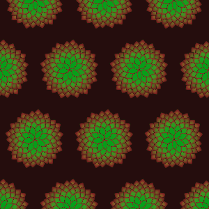
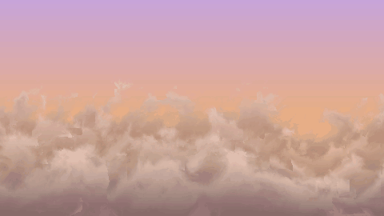
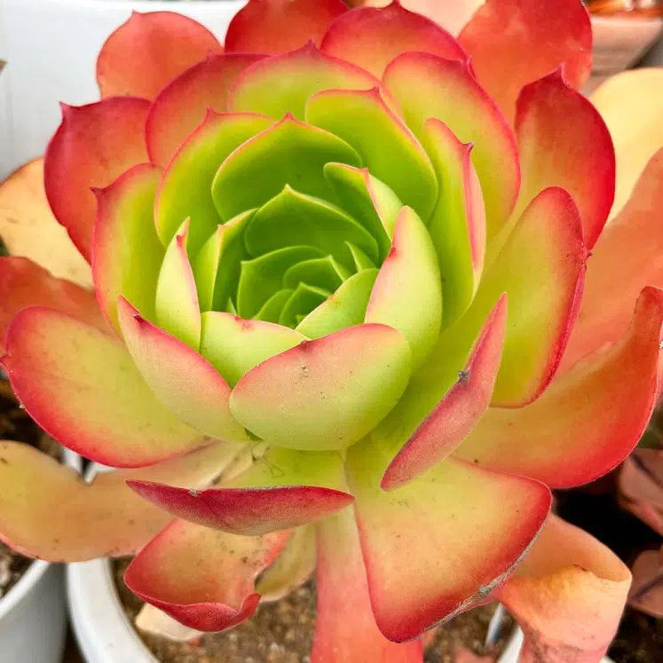
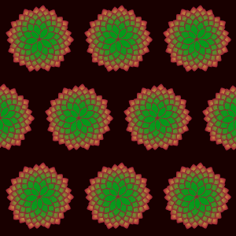
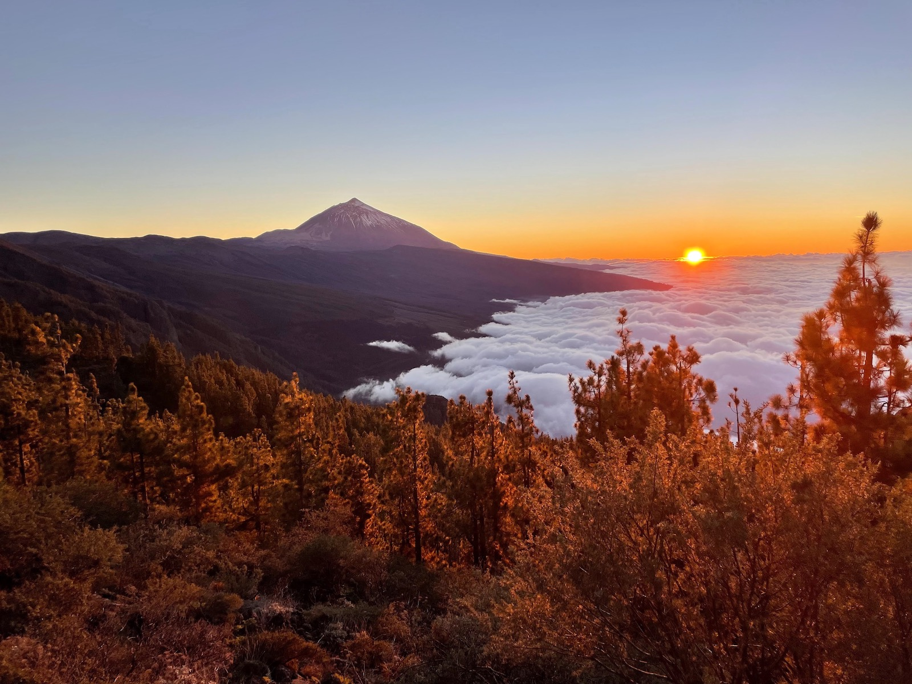
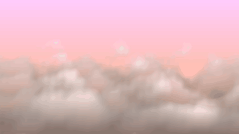
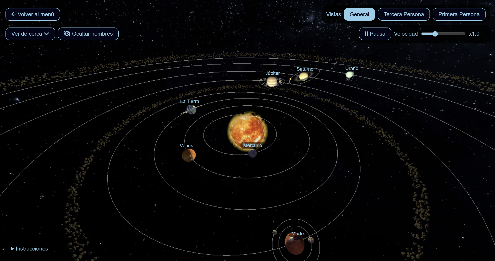
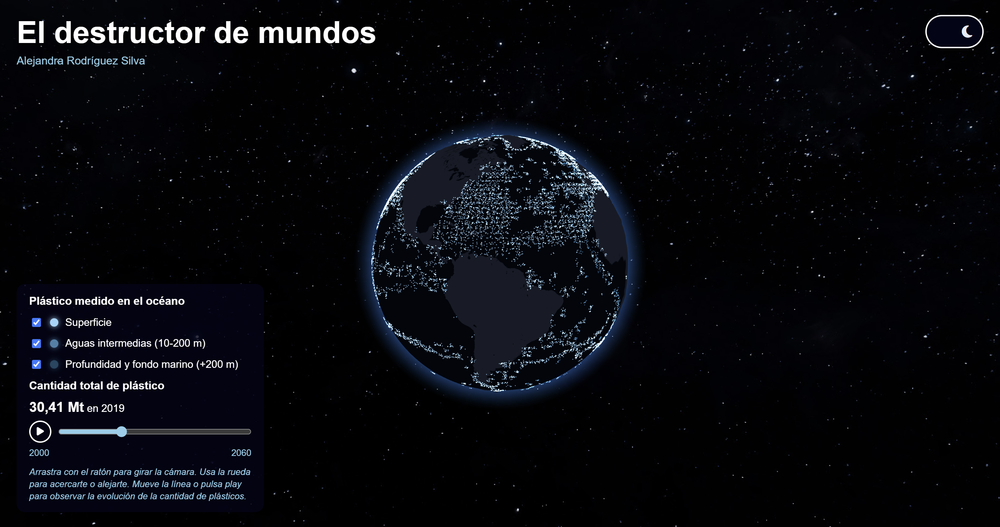

# Práctica 8 - _Shaders_
## [Alejandra Rodríguez Silva](https://github.com/alejandra-rs)

<p align="center">
  
  
</p>

En esta octava práctica se busca experimentar con los _shaders_ de fragmento para realizar composiciones artísticas. Para ello, se han realizado dos composiciones _standalone_, así como la integración de estos códigos GLSL en las prácticas anteriores ([Práctica 6](../prac-6/) y [Práctica 7](../prac-7/)).

Para las composiciones individuales, se ha tomado como inspiración la naturaleza, pues en ella conviven los patrones y la aleatoriedad, precisamente dos de las herramientas principales de un _shader_. Y, para hacerlo más endémico, se han representado elementos de la naturaleza canaria: el **_Aeonium canariense_**, una suculenta propia de las islas, y el **mar de nubes** que aparece sobre las medianías al atardecer.

## Índice

- [Ejecución](#ejecución)
- [Aeonium canariense](#aeonium-canariense)
  - [Inspiración](#inspiración)
  - [Implementación](#implementación)
  - [Proceso de desarrollo](#proceso-de-desarrollo)
  - [Versión reducida](#versión-reducida)
- [Mar de nubes](#mar-de-nubes)
  - [Inspiración](#inspiración-1)
  - [Implementación](#implementación-1)
  - [Proceso de desarrollo](#proceso-de-desarrollo-1)
  - [Versión reducida](#versión-reducida-1)
- [_Shaders_ en otras prácticas](#shaders-en-otras-prácticas)
  - [_Shaders_ en la Práctica 6](#shaders-en-la-práctica-6)
  - [_Shaders_ en la Práctica 7](#shaders-en-la-práctica-7)
- [Fuentes](#fuentes)


## Ejecución

Cada composición tiene una versión legible y comentada y una versión reducida (_tiny code_) de menos de 512 bytes. Cualquiera puede ser consultada pegando su contenido en un visor de _shaders_, como puede ser el [editor de The Book of Shaders](https://editor.thebookofshaders.com/).

<div align="center">

| Composición | Versión legible | Versión reducida |
| --- | --- | --- |
| Aeonium canariense | [`aeonium.frag`](./aeonium.frag) (3336 B) | [`aeonium_tiny.frag`](./aeonium_tiny.frag) (**510 B**) |
| Mar de nubes | [`clouds.frag`](./clouds.frag) (4619 B) | [`clouds_tiny.frag`](./clouds_tiny.frag) (**510 B**) |

<sub>_N.B.: El tamaño de los archivos se ha medido inspeccionando las propiedades de cada uno de ellos en el explorador._</sub>
</div>

Los _shaders_ de fragmento reciben como _uniforms_ de entrada:
- `u_resolution`: tamaño de la ventana en píxeles (ancho y alto).
- `u_time`: tiempo transcurrido desde el inicio de la ejecución.
- `u_mouse`: posición del cursor del ratón, en píxeles (solo en el mar de nubes).

## Aeonium canariense

<p align="center">
  <a href="https://todoparatuhuerta.com/suculentas/aeonium-canariense/"></a>
  
  <br>
  <sub><i>Izquierda: <a href="https://todoparatuhuerta.com/suculentas/aeonium-canariense/"><i>Aeonium canariense</i></a>. Derecha: <a href="./aeonium.frag"><code>aeonium.frag</code></a></i></sub>
</p>

### Inspiración

La _Aeonium canariense_ es una suculenta endémica de Canarias. Es un ejemplo de patrones que aparecen en la naturaleza, pues sus hojas crecen en una disposición específica (**filotaxis**). Además, conforme aumenta la edad de las hojas, se vuelven más grandes y rojizas. Todos estos elementos se han tomado en consideración al reproducir la planta en el _shader_.

El resultado es una plantación de rosetas dispuestas en un mosaico (_brick tiles_). Cada roseta se construye hoja a hoja, y varía con el tiempo en rotación y tamaño.

### Implementación

El _shader_ ([`aeonium.frag`](./aeonium.frag)) sigue, para cada píxel, los siguientes pasos:

1. **Coordenadas.** Se normaliza la posición del píxel con `(2. * gl_FragCoord.xy - u_resolution) / u_resolution.y`, que deja el origen en el centro de la ventana y el eje vertical entre -1 y 1.

2. **Mosaico.** Para formar el mosaico de rosetas, se ha tomado como inspiración la generación de ladrillos propuesta en el libro de referencia ([`brickTile()`, _The Book of Shaders_](https://thebookofshaders.com/09/)). Por esto, se divide la ventana en celdas con `fract`, desplazando las filas impares de media celda para ubicar las suculentas en diagonal. Cada celda se remapea a [-1, 1], para dibujar independientemente cada roseta centrada en ella. Además, se amplían las coordenadas (`st *= 1.5`), para mostrar aproximadamente unas tres plantas en vertical.

3. **Posición de las hojas.** Esta especie hace crecer sus hojas a su alrededor siguiendo la _**filotaxis**_, esto es, se posicionan en forma de espiral, con un ángulo entre cada una de ellas de 137,5º (_ángulo dorado o áureo_). Este comportamiento se replica en el _shader_, rotando cada hoja este mismo ángulo (`GOLDEN_ANG`) respecto de la anterior. De esta forma, se dibujan las 89 hojas (_número de Fibonacci, la naturaleza está llena de matemáticas..._) dentro de un bucle, en orden decreciente de edad (del exterior al interior). Su longitud `L` también depende de la edad, haciéndola crecer conforme las hojas son más antiguas.

4. **Colocación de cada hoja.** Una vez calculados su ángulo y su longitud, se rota cada hoja respecto de la anterior, y se desplaza de forma que su base quede en el centro de la roseta. A nivel de código, esto equivale a realizar comprobaciones de pertenencia tras girar el píxel en sentido contrario (`rotate2d`) y desplazarlo `+L`.

5. **Forma de la hoja.** Cada hoja es una elipse que se deforma para estrecharse en la base y en la punta. Concretamente, se modela la curva de su forma como `pow(sin(PI * pow(u, 0.85)), 0.35)`. Además, la distancia del píxel a esta elipse (`d`) indica si pertenece a la hoja (`d < 1`), dato que se reutiliza para colorear los bordes.

6. **Color.** Cada hoja tiene un degradado que comienza en la base verde y se modifica conforme se aproxima a la punta. Este último color se vuelve más anaranjado conforme la hoja es más vieja. Para diferenciar mejor las hojas, se añaden un borde rojizo y un contorno oscuro que las separa. Además, las hojas más viejas se oscurecen, para dar sensación de profundidad.

7. **Composición.** Cada hoja se genera sobre el resultado de las anteriores con `mix`, usando `smoothstep(0.95, 1., d)` para suavizar los bordes. Las hojas jóvenes quedan por encima de las viejas, al dibujarse después.

La animación se controla con `u_time`, causando el giro de las rosetas (`0.2 * u_time`) y la oscilación de su tamaño (modificación de la longitud de las hojas con `sin(u_time)`).

### Proceso de desarrollo

1. Generación de 1 única flor en coordenadas polares, usando funciones simples para el contorno, y `mix` y `smoothstep` para el degradado y la máscara.
2. Rosetas a partir de anillos concéntricos con desfases angulares. Sin embargo, este enfoque no era realista, y no permitía tener hojas separadas con la misma forma.
3. Rosetas generando sus hojas una a una, colocándolas haciendo uso del ángulo áureo.
4. Retoques sobre el algoritmo para modificar la forma de la hoja, los colores, los bordes y las variaciones según la edad.
5. Mosaico para introducir varias suculentas, simulando una plantación.

### Versión reducida

<p align="center">
  
  
  <br>
  <sub><i>Izquierda: <a href="./aeonium.frag"><code>aeonium.frag</code></a>. Derecha: <a href="./aeonium_tiny.frag"><code>aeonium_tiny.frag</code></a></i></sub>
</p>

[`aeonium_tiny.frag`](./aeonium_tiny.frag) ocupa **510 bytes**. En una primera fase, el fichero original se redujo a unos 627 B, eliminando y renombrando variables, eliminando espacios y anidando las llamadas a `mix()`. El resto de cambios resultaron en simplificaciones con efectos (cuasi) imperceptibles:

- **Coordenadas sin centrar.** Al no centrar las coordenadas y usar directamente `gl_FragCoord.xy / u_resolution.y * 3.`, el patrón se desplaza.
- **Reducción de la precisión.** Los números de tipo `float` se redondean a una precisión de 1-2 decimales (por ejemplo, el ángulo áureo pasa de `2.39996` a `2.4`).
- **Rotación sin función.** Como las funciones trigonométricas son periódicas, la función `rotate2d` se puede aproximar a `mat2(cos(ángulo + vec4(0, 11, 33, 0)))`, haciendo coincidir los valores casi exactamente con los de la matriz de rotación.
- **Forma de la hoja simplificada.** Se simplifica la forma de la hoja a `sqrt(abs(sin(3. * u)))`. Se redondean las constantes y eliminan los ajustes finos.
- **Efectos eliminados.** Como último recurso, se eliminan el contorno oscuro entre hojas y el oscurecimiento de las hojas viejas. Se logran mantener aun así el borde rojizo, el giro y el cambio de tamaño de las rosetas.


## Mar de nubes

<p align="center">
  <a href="https://randomtrip.es/guia-islas-canarias/"></a>
  
  <br>
  <sub><i>Izquierda: <a href="https://randomtrip.es/guia-islas-canarias/">mar de nubes con el Teide al fondo</a>. Derecha: <a href="./clouds.frag"><code>clouds.frag</code></a>, con el ratón moviéndose entre las nubes.</i></sub>
</p>

### Inspiración

El _mar de nubes_ es un fenómeno muy habitual en las medianías canarias. Se produce cuando los alisios arrastran aire húmedo, que junto con la inversión térmica forman una capa de nubes a media altura de las montañas. Visto desde la cumbre, parecen olas rompiendo contra las laderas, de ahí su nombre, pues recuerda a un mar. Contrariamente a la geometría del _Aeonium_, este _shader_ representa la aleatoriedad de la naturaleza.

El _shader_ resultante muestra varias capas de nubes que se desplazan a distintas velocidades sobre el atardecer. Además, se puede interactuar con ellas usando el ratón, que abre el paso sobre ellas.

### Implementación

El _shader_ ([`clouds.frag`](./clouds.frag)) sigue, para cada píxel, los siguientes pasos:

1. **Coordenadas.** Se normaliza la posición del píxel con `gl_FragCoord.xy / u_resolution.y`, que deja el origen en la esquina inferior izquierda y el eje vertical entre 0 y 1. La posición del ratón también se normaliza de la misma forma.

2. **Cielo.** El fondo es un degradado vertical de naranja a morado.

3. **Ruido.** Para generar la forma de las nubes, se ha implementado el ruido fractal propuesto en el libro de referencia ([_The Book of Shaders_](https://thebookofshaders.com/13/)). Este parte de un número pseudoaleatorio (`random`), con el que se genera ruido interpolando valores aleatorios sobre una cuadrícula (`noise`). El movimiento _browniano_ (`fbm`) resulta de la concatenación de 6 capas u octavas de este ruido, con detalle creciente e intensidad decreciente. Además, se deforman las coordenadas usando _domain warping_ (modificar el ruido con el propio ruido), consiguiendo formas más retorcidas.

4. **Capas.** Se dibujan 4 capas de nubes, desde la más lejana hasta la más cercana. Cuanto más lejana es la capa, es más alta, más lenta y con un ruido más fino. Esto permite generar efecto de profundidad. Además, para que cada capa de nubes tenga una forma distinta, se calcula un _offset_ aleatorio para cada una de ellas.

5. **Forma de la nube.** Cada capa tiene una altura base deformada por el ruido, que forma el contorno superior de las nubes. Los píxeles que quedan por debajo de esta línea pertenecen a la nube, y los que quedan por encima, al cielo. Como en el _shader_ de la _Aeonium_, `depth` permite conocer si el píxel se encuentra o no dentro de la nube, y `smoothstep` difumina los bordes.

6. **Color.** Las nubes tienen un degradado de beis a morado más o menos intenso según su profundidad, y su brillo varía con el ruido. Además, las capas lejanas son más translúcidas, simulando la bruma.

7. **Ratón.** Para interactuar con las nubes, se calcula una campana de Gauss alrededor del cursor (`exp(-dot(dv, dv) * MOUSE_RADIUS)`). Este valor se resta a `depth`, para disminuir la profundidad de cada capa de nubes a su alrededor.

La animación se controla con `u_time`, que desplaza horizontalmente el ruido de cada capa según su velocidad.

### Proceso de desarrollo

1. Degradado del cielo y ruido fractal a partir de las funciones del libro de referencia.
2. Una única capa de nubes, definida por su altura, que se desplaza con el tiempo.
3. _Domain warping_ para obtener formas más realistas.
4. Varias capas con parámetros dependientes de su profundidad, añadiendo bruma y sombras.
5. Interacción con el ratón. En un primer intento, se realizaba una acción de _push_, pero la experiencia era anti-natural. Por esto, finalmente, solo se cambia la profundidad de las nubes alrededor del cursor.
6. Refactorización del código, y definición de constantes.

### Versión reducida

<p align="center">
  
  
  <br>
  <sub><i>Izquierda: <a href="./clouds.frag"><code>clouds.frag</code></a>. Derecha: <a href="./clouds_tiny.frag"><code>clouds_tiny.frag</code></a></i></sub>
</p>

[`clouds_tiny.frag`](./clouds_tiny.frag) ocupa **510 bytes**. Además de eliminar y renombrar variables y eliminar espacios, se realizaron los siguientes cambios:

- **Ruido más simple.** El ruido implementado se sustituye por un producto de senos (`sin(p.x) * sin(p.y)`). Para evitar patrones alineados, se rotan y escalan las coordenadas entre octavas.
- **Menos octavas.** Se usan 5 octavas en lugar de 6, y su intensidad se calcula con `exp2`.
- **Sin _domain warping_.** Se elimina el _domain warping_, perdiendo detalles en las irregularidades.
- **Capas simplificadas.** El _offset_ que afecta a la forma del ruido de cada capa pasa a ser fijo en lugar de aleatorio.
- **Bordes y colores simplificados.** Se sustituye `smoothstep` por rampas lineales (`clamp`), y se simplifican (redondean) los colores del cielo y de las nubes.

Aun así, se logran mantener las capas, la bruma y la interacción con el ratón.


## _Shaders_ en otras prácticas

### _Shaders_ en la Práctica 6

<p align="center">
  
  <br>
  <sub><i>Sol con shaders en la práctica 6</i></sub>
</p>

Tras la entrega de la práctica 6, se ha modificado el Sol añadiéndole dos _shaders_: uno para su superficie y otro para crearle una corona a su alrededor. El código se encuentra en [`sun.js`](../prac-6/src/objects/sun.js), y se aplica en `createStar` (llamada a `addSunShaders`).

Ambos _shaders_ usan el mismo ruido fractal que el mar de nubes. No obstante, este se escala para ser calculado en 3 dimensiones para cada punto de la esfera (frente a 2d en el mar de nubes, plano). De no ser así, aparecerían cambios bruscos en la textura.

1. **Superficie.** Para simular el movimiento del plasma, el ruido se desplaza con el tiempo y aclara u oscurece la textura original. Como en el mar de nubes, se aplica _domain warping_ para que las formas sean más irregulares. Además, para aportar más realismo, los bordes se oscurecen ligeramente.

2. **Corona.** La corona se dibuja sobre un plano situado detrás del Sol, que siempre mira hacia la cámara, similar a las técnicas usadas en los primeros videojuegos. Sobre este plano se generan los rayos, utilizando ruido sobre el ángulo de cada píxel alrededor del Sol. Los rayos se desplazan con el tiempo, su brillo disminuye al alejarse y se vuelven más anaranjados.

### _Shaders_ en la Práctica 7

<p align="center">
  
  <br>
  <sub><i>Vista nocturna de la Tierra con shaders en la práctica 7</i></sub>
</p>

A diferencia de la práctica 6, los _shaders_ se entregaron junto con la [práctica 7](../prac-7). Se usan en la vista nocturna del globo:

1. **Halo del globo** ([`globes.js`](../prac-7/src/objects/globes.js)). Para simular la atmósfera, el globo se rodea de una esfera azul un poco más grande, sobre la que se hace visible su cara interior. Esto resulta en la ilusión de que existe un halo alrededor de la tierra. El brillo de este halo depende del ángulo de incidencia respecto de la cámara, haciendo que sea máximo junto a la Tierra y se desvanezca al alejarse.

2. **Puntos de plástico** ([`plastic.js`](../prac-7/src/objects/plastic.js)). Cada medida en el océano se representa con puntos. El _vertex shader_ ajusta su tamaño según la distancia a la cámara, y oculta los que aún no existen en el año elegido. El _fragment shader_ los dibuja como círculos difuminados, que aumentan su brillo conforme se acumulan más medidas.


## Fuentes

### General

- Patricio Gonzalez Vivo y Jen Lowe, [_The Book of Shaders_ - Glosario](https://thebookofshaders.com/glossary/). Consulta de las funciones de GLSL.
- [Editor de _The Book of Shaders_](https://editor.thebookofshaders.com/). Desarrollo y prueba de los _shaders_.

### Aeonium canariense

**Documentación:**

- _The Book of Shaders_:
  - [Capítulo 3 - Uniforms](https://thebookofshaders.com/03/)
  - [Capítulo 5 - Shaping functions](https://thebookofshaders.com/05/)
  - [Capítulo 6 - Colors](https://thebookofshaders.com/06/)
  - [Capítulo 7 - Shapes](https://thebookofshaders.com/07/)
  - [Capítulo 8 - Matrices](https://thebookofshaders.com/08/)
  - [Capítulo 9 - Patterns](https://thebookofshaders.com/09/)
  - [Capítulo 10 - Random](https://thebookofshaders.com/10/)

**Otras referencias:**

- [_Phyllotaxy and Fibonacci sequence_ (Microbe Notes)](https://microbenotes.com/phyllotaxy-and-fibonacci-sequence/).
- [_Aeonium canariense_ (Todo para tu huerta)](https://todoparatuhuerta.com/suculentas/aeonium-canariense/). Información y fotografía de la planta.

**Inteligencia Artificial:**

La reducción de la versión legible se hizo manualmente hasta unos 627 B. Al no conseguir bajar de esa cifra, se consultó a _Claude_ con el siguiente _prompt_, solicitando consejos para reducir el tamaño:

<details>
<summary>Código adjunto (627 B)</summary>

```glsl
precision highp float;uniform vec2 u_resolution;uniform float u_time;mat2 rx(float a){return mat2(cos(a),-sin(a),sin(a),cos(a));}void main(){vec2 p=gl_FragCoord.xy/u_resolution.y*3.,q;p.x+=mod(floor(p.y),2.)*.5;p=fract(p)*2.-1.;vec3 c=vec3(.12,0,0);for(float i=88.;i>=0.;i--){float a=i/89.,L=.075+.375*pow(a,.4)+.05*sin(u_time);q=rx(i*2.4+.2*u_time)*p;q.x-=L;float u=clamp((q.x+L)/(2.*L),0.,1.),d=length(q/vec2(L,L*.5*pow(sin(3.1*pow(u,.9)),.3)));;c=mix(mix(mix(mix(vec3(0,.6,.1),vec3(1,.5,.3),a*u),vec3(.6,.1,.2),smoothstep(.6,1.,d)),vec3(0,.2,0),smoothstep(.9,1.,d))*(1.-.3*a),c,smoothstep(.9,1.,d));}gl_FragColor=vec4(c,1);}
```
</details>

> No matter how hard I try, I'm still above 512B for this code. I've renamed variables, collapsed them when possible, and unified the "mix" operations whenever I could. I'm still at 627B though. What do you recommend to make the size even smaller?

La IA sugirió:

- Eliminar la función de rotación, sustituyéndola por una matriz equivalente escrita directamente (truco del desfase del coseno).
- Reestructurar las líneas del bucle `for`, para ahorrar caracteres, evitando declaraciones de variables (con su respectivo tipo) en varias líneas.
- Eliminar los `clamp` innecesarios.

Tras aplicar estos cambios, el código pasó a ocupar **536 B**. El resto de modificaciones hasta llegar a 510 B se hicieron eliminando funcionalidades.

### Mar de nubes

**Documentación:**

- _The Book of Shaders_:
  - [Capítulo 10 - Random](https://thebookofshaders.com/10/)
  - [Capítulo 11 - Noise](https://thebookofshaders.com/11/)
  - [Capítulo 13 - Fractal Brownian Motion](https://thebookofshaders.com/13/)
- Inigo Quilez, [_Domain warping_](https://iquilezles.org/articles/warp/)
- Inigo Quilez, [_fBm_](https://iquilezles.org/articles/fbm/)
- [_Cubic Hermite spline_ (Wikipedia)](https://en.wikipedia.org/wiki/Cubic_Hermite_spline)

**Referencias:**

- [_Guía de las Islas Canarias_ (Randomtrip)](https://randomtrip.es/guia-islas-canarias/). Fotografía del mar de nubes.

**Inteligencia Artificial:**

Nuevamente, se usó _Claude_ para reducir el tamaño del fichero más allá de 586 B. Sabiendo de la realización del _shader_ anterior que existían simplificaciones hechas para _tiny code_, se realizó el siguiente prompt:

> Once again, I'm stuck at making the code smaller. I'm currently at 586 B. I know there must be some work-around trick to simplify the functions in my code. Please, check the functions for noise and fbm introduced in these links: https://thebookofshaders.com/11/ and https://thebookofshaders.com/13/. Can you guide me towards some simplification of these functions to make my code <512B? 

_Claude_ sugirió:
-  Sustituir el ruido existente por un producto de senos.
- Calcular la intensidad de las octavas con `exp2`.

Tras aplicar estos cambios, se logró reducir el fichero a **510 B**.

### _Shaders_ en otras prácticas

- [`ShaderMaterial` (documentación de `three.js`)](https://threejs.org/docs/#api/en/materials/ShaderMaterial)
